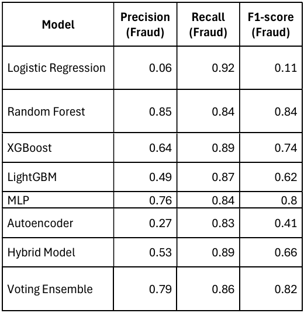
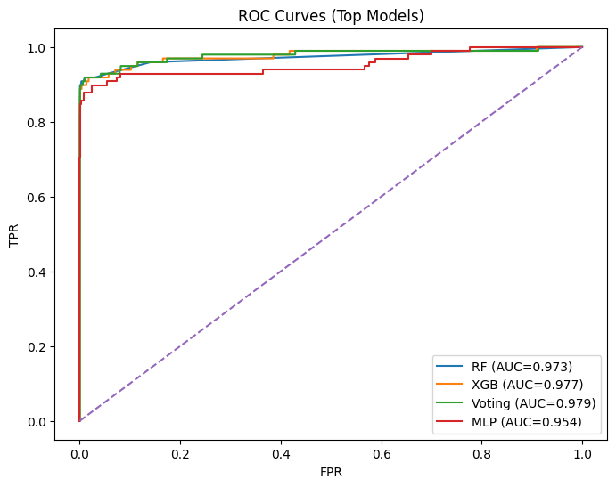
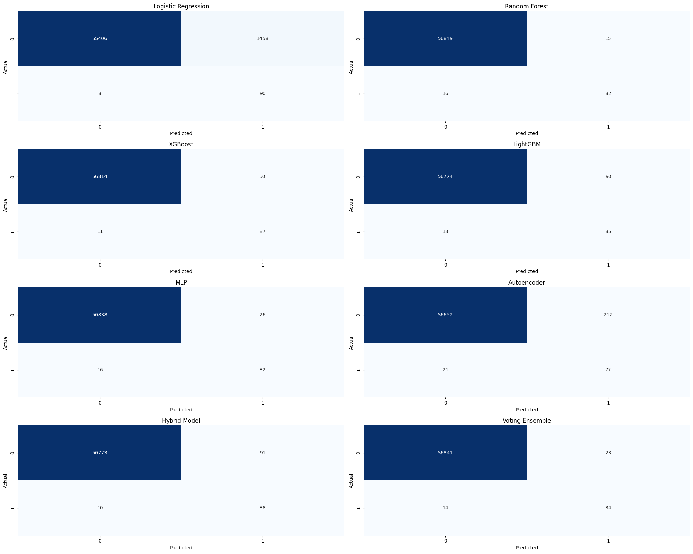

# Credit Card Fraud Detection Using Machine Learning

This project compares machine learning, ensemble and anomaly detection techniques for detecting fraudulent credit card transactions. It was completed as part of my MSc in Business Analytics at Dublin Business School. The full write-up is in [Credit_Card_Fraud_Detection_Dissertation.pdf](Credit_Card_Fraud_Detection_Dissertation.pdf).

## Key results

Eight models were evaluated on a held-out test set of 56,962 transactions containing 98 frauds.

- **Best overall:** Random Forest, with F1 0.84, precision 0.85, recall 0.84 and ROC-AUC 0.97.
- **Highest ROC-AUC:** the hybrid Autoencoder + LightGBM model, with ROC-AUC 0.98. It also caught 90% of fraud cases, at a precision of 0.49.
- **Highest recall:** Logistic Regression caught 92% of fraud cases, but with a precision of just 0.06, so it would flag far too many legitimate transactions to be usable.

## Dataset

The project uses the [European Cardholders Credit Card Fraud dataset](https://www.kaggle.com/datasets/mlg-ulb/creditcardfraud). It has 284,807 transactions made over two days in September 2013, of which 492 (0.17%) are fraudulent. Features `V1` to `V28` are anonymised PCA components; `Time` and `Amount` are the original values.

The dataset is not included in this repository. Download `creditcard.csv` from Kaggle (see [Data/dataset_link.txt](Data/dataset_link.txt)).

## Method

1. **Exploratory analysis:** class distribution, transaction amount and time distributions, and feature correlations.
2. **Preparation:** standardised `Time` and `Amount`, then made a stratified 80/20 train/test split.
3. **Class imbalance:** applied SMOTE to the **training set only**, so no synthetic data leaks into the test set.
4. **Modelling:** trained the eight models listed below.
5. **Evaluation:** compared precision, recall, F1, ROC-AUC and PR-AUC, with confusion matrices and ROC curves. Accuracy is reported but not relied on, because predicting "not fraud" for every transaction would already score 99.8%.

## Models and results

Results are sorted by F1 score for the fraud class.

| Model | Precision | Recall | F1 | ROC-AUC | PR-AUC |
|---|---|---|---|---|---|
| Random Forest | 0.845 | 0.837 | **0.841** | 0.973 | **0.875** |
| Voting Ensemble (Random Forest + XGBoost, soft voting) | 0.785 | 0.857 | 0.820 | 0.979 | 0.874 |
| MLP Neural Network | 0.759 | 0.837 | 0.796 | 0.954 | 0.826 |
| XGBoost | 0.635 | 0.888 | 0.740 | 0.977 | 0.869 |
| Hybrid (Autoencoder reconstruction error + LightGBM) | 0.492 | 0.898 | 0.635 | **0.983** | 0.856 |
| LightGBM | 0.486 | 0.867 | 0.623 | 0.950 | 0.821 |
| Autoencoder (anomaly detection) | 0.266 | 0.786 | 0.398 | 0.943 | 0.585 |
| Logistic Regression (baseline) | 0.058 | **0.918** | 0.109 | 0.970 | 0.725 |

The autoencoder was trained only on legitimate transactions and flags fraud by high reconstruction error. The hybrid model adds that reconstruction error as an extra feature for LightGBM.



| ROC curves | Confusion matrices |
|---|---|
|  |  |

## Running the notebook

1. Install the dependencies:
   ```
   pip install -r requirements.txt
   ```
2. Download `creditcard.csv` from Kaggle.
3. Open `Fraud_Detection.ipynb` and change the `pd.read_csv(...)` path to where you saved the file. The notebook was written in Google Colab and reads from Google Drive.

## Repository contents

| Path | Contents |
|---|---|
| `Fraud_Detection.ipynb` | Full analysis: exploration, preparation, modelling and evaluation |
| `Credit_Card_Fraud_Detection_Dissertation.pdf` | Dissertation write-up |
| `Images/` | Class distribution, model comparison, ROC curves and confusion matrices |
| `Data/dataset_link.txt` | Link to the dataset |
| `requirements.txt` | Python dependencies |

## Tools

Python, pandas, NumPy, scikit-learn, imbalanced-learn (SMOTE), XGBoost, LightGBM, TensorFlow/Keras, Matplotlib, Seaborn.

## Possible improvements

- Tune each model's decision threshold to trade precision against recall for a given business cost of fraud.
- Use time-based validation instead of a random split, to better reflect real-world deployment.
- Add explainability (for example SHAP) to show which features drive fraud predictions.
